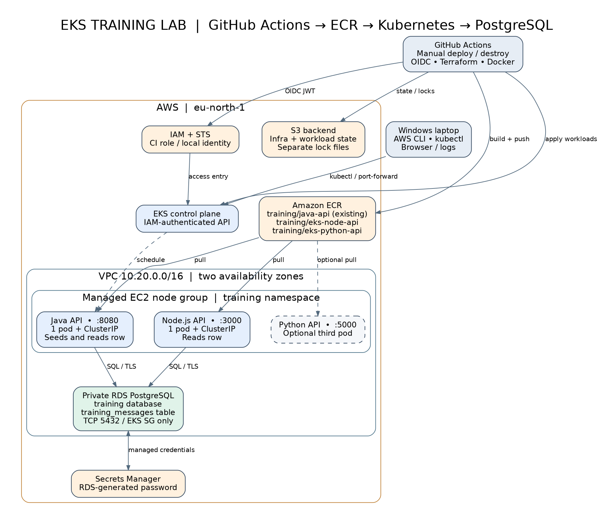

# EKS training lab — GitHub Actions, Terraform, ECR and RDS

The original `pipeline.yml` (parallel Docker builds, Java ECR publishing and simulated deployments) is retained. The new `eks-training.yml` is a separate, manually triggered **real deployment** from `main`.



## Modules and resources

- `terraform/infra/modules/eks`: VPC spanning two AZs, public worker subnets, isolated DB subnets, EKS control plane, one t3.medium managed worker, node IAM role and EKS access entries.
- `terraform/infra/modules/database`: private RDS PostgreSQL, db.t4g.micro, 20 GiB gp3, database `training`. Secrets Manager manages the master password. DB security group allows TCP 5432 only from the EKS cluster security group.
- Existing ECR `training/java-api` is referenced, not managed or destroyed. New repositories: `training/eks-node-api` and `training/eks-python-api` (immutable tags).
- `terraform/workloads/modules/api`: reusable one-replica Deployment and ClusterIP Service. `terraform/workloads/modules/python`: optional Python API module, disabled by default. Namespace `training` has exactly two application pods by default.
- Java seeds table `training_messages` with one sample row. Both Java and Node query it every 15 seconds. Python uses the existing Flask app. GitHub securely pipes the Secrets Manager value into a Kubernetes Secret; the password is not in Terraform state or workflow logs. Redeploy after secret rotation.

## 1. One-time configuration

Reuse account `686511309747`, region `eu-north-1`, ECR `training/java-api`, GitHub `04112026/soda-panipuri` and existing OIDC provider `token.actions.githubusercontent.com`. Do not change the working ECR-only role.

**AWS: new infrastructure IAM role.** IAM → Roles → Create role → Web identity → GitHub provider → audience `sts.amazonaws.com`. Name `GitHubActions-EKS-Infra-Role`. Edit trust using `docs/infra-role-trust.json` (numeric IDs observed in the previous session; main branch only). Require protected main with reviews. Terraform needs permissions to provision IAM roles, VPC, EKS, RDS, ECR and read/write state and secrets. In an isolated disposable training account ONLY, you can temporarily attach `AdministratorAccess` to this dedicated role; this is broad and unsafe for shared/production accounts. For those, have the administrator supply a scoped provisioning role. Remove lab privileges after destruction. No permanent access keys required.

**Pipeline-managed bootstrap:** No manual S3 creation or new GitHub settings are required. The workflow defaults to the existing infrastructure role ARN and the dedicated `training-tfstate-686511309747` bucket in eu-north-1. It creates the bucket if absent, blocks public access, enables versioning and SSE-S3 encryption before Terraform init. The bucket is retained during destroy. If you already use a dedicated state bucket, set the `TF_STATE_BUCKET` repository variable **before** deploying to continue using that same state; never switch buckets without migrating state. The bootstrap configures the selected bucket and should only be used on a dedicated lab state bucket.

**Optional laptop access:** To connect locally, use an existing IAM user/role ARN (not root or an STS session ARN) and enter it in the workflow's `local_principal_arn` input or set the `EKS_LOCAL_PRINCIPAL_ARN` repository variable. If both are blank, only the CI role is granted administrative Kubernetes access; you can still inspect logs from Actions. Use the same optional ARN on subsequent deploys to retain that access. If needed, create a console-enabled IAM user `training-eks-local` with MFA, `SignInLocalDevelopmentAccess` if required for `aws login`, and `docs/local-eks-policy.json` (DescribeCluster). No permanent access keys required. The workflow does not create a local user automatically.

**GitHub optional overrides:**

| Type | Name | Value |
|---|---|---|
| Secret | `AWS_INFRA_ROLE_ARN` | Override the default infrastructure role ARN if different |
| Variable | `TF_STATE_BUCKET` | Override the default dedicated state bucket name if needed |
| Variable | `EKS_LOCAL_PRINCIPAL_ARN` | Optional existing IAM user or role ARN for local access |
| Existing secret | `AWS_ROLE_ARN` | Leave unchanged; original ECR demo |

## 2. Deploy via GitHub Actions

1. Copy ZIP contents into your existing repo (keep your local `.git`), commit on a branch and merge to `main`.
2. Actions → **EKS Training - Terraform and Deployment** → Run workflow → main → `operation=deploy`. Leave `enable_python=false` for two pods.
3. `infrastructure`: Bootstrap state bucket, then Terraform init, validate, plan, apply. Creates EKS, private DB and repos. This is chargeable and can take many minutes.
4. `publish`: three parallel Docker build/push jobs. A unique tag includes Git SHA, run ID and attempt. Kubernetes workers pull images from ECR using their IAM role (no imagePullSecret).
5. `deploy`: configure kubeconfig, namespace and secret, apply separate workload Terraform state, display pod logs. Java initializes the table; Node retries until it exists.
6. If a run fails, correct the error and trigger a fresh deploy with the same inputs. Durable state prevents unnecessary recreation. Do not delete state to fix errors, or unlock while a workflow runs.

## 3. Connect from Windows PowerShell

Install AWS CLI v2 and kubectl compatible with cluster version. If missing: `winget install -e --id Kubernetes.kubectl`. Reopen PowerShell. Authenticate as the **authorized IAM user/role**, NOT root:

```powershell
aws login --region eu-north-1
aws sts get-caller-identity
aws eks update-kubeconfig --name training-eks --region eu-north-1
kubectl get nodes
kubectl -n training get pods,svc
kubectl -n training logs deployment/java-api --tail=10
kubectl -n training logs deployment/node-api --tail=10
```

If using a named AWS profile, set `$env:AWS_PROFILE = 'your-profile'` first. Verify `aws sts get-caller-identity` matches the intended identity; use `kubectl config current-context` before operating. Access-entry propagation can take a short time.

Expected logs:

```text
[DB] Java API read: Hello from RDS PostgreSQL
[DB] Node API read: Hello from RDS PostgreSQL
```

Run in separate PowerShell terminals (keep them open):

```powershell
kubectl -n training port-forward service/java-api 8080:8080
# In second terminal:
kubectl -n training port-forward service/node-api 3000:3000
```

Open http://localhost:8080 and http://localhost:3000. Both return JSON with the DB message and `ready: true`. Optional Python: `kubectl -n training port-forward service/python-api 5000:5000`. Stop with Ctrl+C. No public application Load Balancer or public DB needed.

## 4. SQL demo from your local terminal

RDS stays private. Create a short-lived PostgreSQL client pod from PowerShell (not a permanent third workload):

```powershell
@'
apiVersion: v1
kind: Pod
metadata:
  name: db-client
  namespace: training
spec:
  restartPolicy: Never
  automountServiceAccountToken: false
  containers:
    - name: psql
      image: postgres:16-alpine
      command: ["sleep", "3600"]
      envFrom:
        - secretRef:
            name: training-db
'@ | kubectl apply -f -
kubectl -n training wait --for=condition=Ready pod/db-client --timeout=120s
kubectl -n training exec -it db-client -- sh
```

Inside Linux shell:

```sh
PGPASSWORD="$DB_PASSWORD" PGSSLMODE=require psql -h "$DB_HOST" -U "$DB_USER" -d "$DB_NAME"
```

In psql:

```sql
SELECT * FROM training_messages;
UPDATE training_messages SET message='Updated during live training' WHERE id=1;
SELECT * FROM training_messages;
\q
```

Exit shell, then run:

```powershell
kubectl -n training logs deploy/java-api --tail=5
kubectl -n training logs deploy/node-api --tail=5
kubectl -n training delete pod db-client
```

Both applications should show the updated DB message within approximately one polling interval (15 seconds) in logs and local HTTP responses.

## 5. Troubleshoot and destroy

- OIDC: check new role ARN, numeric subject and audience; main only. Old ECR role cannot create infrastructure.
- S3: check bucket name/region/permissions. Verify no other workflow runs before resolving stale state locks.
- EKS Unauthorized: check identity and access entry. Administrator can run `aws eks list-access-entries --cluster-name training-eks --region eu-north-1`.
- ImagePullBackOff: `kubectl -n training describe pod <pod>`; check ECR image tag and worker ECR pull policy.
- DB retries: check RDS status, DB security group, network, secret and logs. Node may initially report missing table until Java seeds it. Do not print secret values. APIs without DB env variables still run locally.

**Destroy:** Actions → EKS Training - Terraform and Deployment → Run workflow → main → `operation=destroy`. Workloads are removed first, then EKS, VPC, RDS and new node/python ECR repositories/images. DB is deleted without snapshot: demo data is lost. Existing Java ECR and original images, S3 state bucket/versions, bootstrap IAM role and laptop identity remain. New Java demo tags in the existing registry also remain; clean manually if wanted. Verify AWS resources are gone, remove lab-role privileges and optionally remove state bucket only after cleanup. If destroy fails, fix and retry before removing the role or state.

**Lab tradeoffs:** EKS control plane, EC2, RDS, disk, public IPv4, Secrets Manager, ECR and S3 cost money. Public worker subnets avoid NAT expense; managed nodes have no public application ingress. EKS API is IAM-authenticated but publicly reachable to support hosted GitHub runners. Private RDS and ClusterIP services are not internet-exposed. In production use private workers, controlled API endpoint, scoped IAM, approvals, HA, backups, per-app DB users, network policies, workload identity, RDS CA verification and automatic secret rotation. This demo uses the master DB credentials and TLS encryption without CA verification; never use it for real data. Kubernetes version is selected by AWS. No live AWS deployment was executed by the author.

References: [EKS access entries](https://docs.aws.amazon.com/eks/latest/userguide/access-entries.html), [ECR pulls](https://docs.aws.amazon.com/AmazonECR/latest/userguide/ECR_on_EKS.html), [CLI login](https://docs.aws.amazon.com/cli/latest/userguide/cli-configure-sign-in.html), [Terraform S3 backend](https://developer.hashicorp.com/terraform/language/backend/s3).
